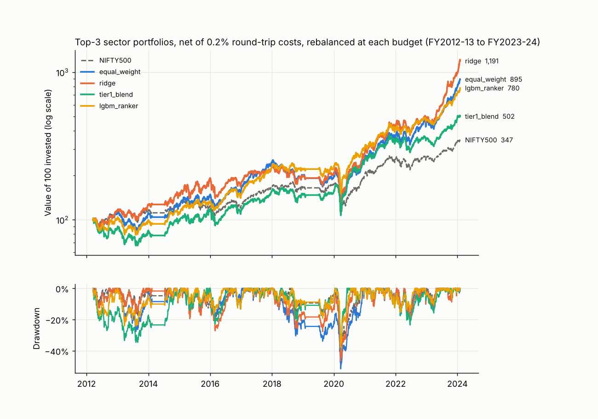
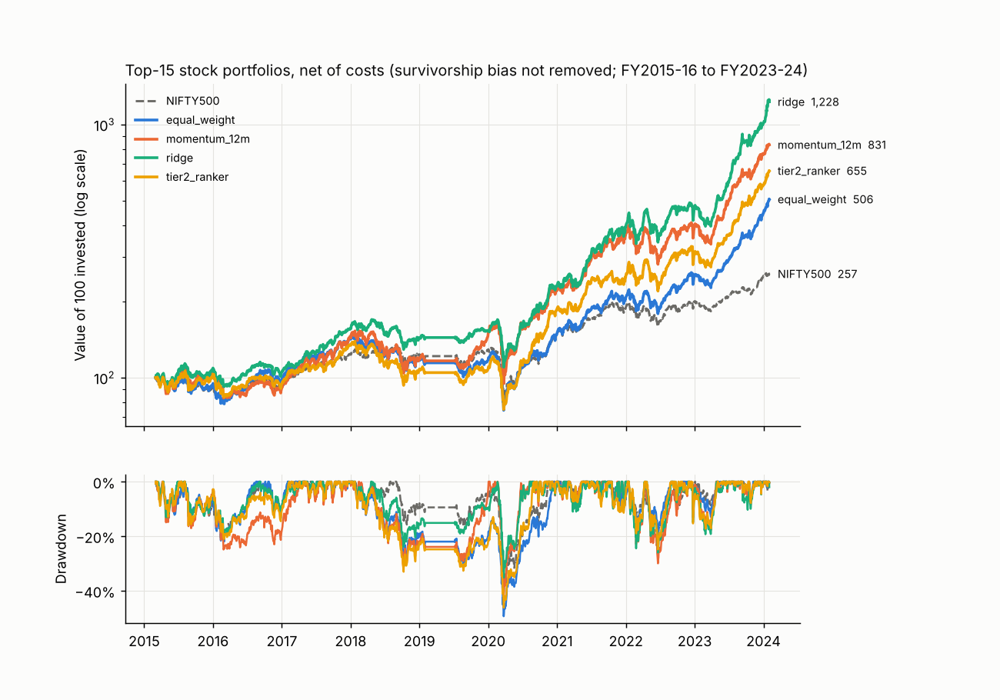

# Phase 8 evidence: does the budget data add anything beyond price momentum?

Generated by `make evidence` (`src/bsp/evidence/`). Every number is out-of-sample (walk-forward) or computed on the unlocked years FY2005-06 to FY2023-24; the FY2024-25 / FY2025-26 hold-out and the live year were not loaded. 12 sector test years (9 for stocks) make every statistic here weak: read the intervals, not just the means. Nothing is investment advice.

## 1. The question, answered with numbers

Same model, same folds, with price features only (momentum and volatility) against price plus budget features (allocation growth, capex share, schemes, fiscal stance, surprise, execution credibility). Difference per test year, then averaged:

| Model | IC gain from budget data | 95% bootstrap CI | t | p (two-sided) | Top-3 net excess gain | 95% CI |
| --- | --- | --- | --- | --- | --- | --- |
| lgbm_ranker | -0.168 | [-0.350, -0.004] | -1.85 | 0.091 | -3.2% | [-9.3%, 2.4%] |
| ridge | -0.049 | [-0.168, 0.077] | -0.74 | 0.475 | -2.6% | [-6.8%, 1.8%] |

**Bottom line: in these 12 test years the budget features did not add detectable predictive power beyond price momentum and volatility; both point estimates are negative.**

**Answer.** lgbm_ranker: budget data lowers IC by 0.168 (interval excludes 0; t-test p 0.091); ridge: the IC difference is -0.049, interval includes 0 (t-test p 0.475), so no detectable gain or loss. For scale, re-running the same LightGBM model with 4 different seeds moves its mean IC between 0.038 and 0.054 (sd 0.007), so differences smaller than that are noise.

All contrasts (IC difference, a minus b, paired by test year):

| Model | Contrast | IC difference | 95% CI | p |
| --- | --- | --- | --- | --- |
| lgbm_ranker | budget data added to price data | -0.168 | [-0.350, -0.004] | 0.091 |
| lgbm_ranker | budget data alone vs momentum alone | -0.079 | [-0.310, 0.128] | 0.516 |
| lgbm_ranker | price + budget vs momentum alone | 0.011 | [-0.230, 0.263] | 0.932 |
| lgbm_ranker | everything else (FPI, macro, regime) added | 0.021 | [-0.095, 0.154] | 0.749 |
| ridge | budget data added to price data | -0.049 | [-0.168, 0.077] | 0.475 |
| ridge | budget data alone vs momentum alone | -0.037 | [-0.215, 0.152] | 0.715 |
| ridge | price + budget vs momentum alone | 0.163 | [-0.029, 0.353] | 0.143 |
| ridge | everything else (FPI, macro, regime) added | -0.003 | [-0.039, 0.026] | 0.886 |

## 2. Ablations: IC without each feature family

Drop = IC of the full model minus IC without the family (positive = the family helped), paired by test year with a bootstrap CI. `speech_nlp` cannot be ablated: no speech data exists yet, so the panel has no such feature.

### ridge (full model IC 0.185, 22 features)

| Variant | Features | Mean IC | IC drop | 95% CI of drop | Top-3 excess drop |
| --- | --- | --- | --- | --- | --- |
| without budget_money | 17 | 0.220 | -0.035 | [-0.092, 0.006] | -1.3% |
| without execution_credibility | 21 | 0.194 | -0.008 | [-0.024, 0.001] | -0.1% |
| without fpi_flows | 21 | 0.185 | 0.000 | [0.000, 0.000] | 0.0% |
| without macro_controls | 17 | 0.181 | 0.004 | [-0.013, 0.020] | 0.9% |
| without momentum | 18 | 0.215 | -0.030 | [-0.190, 0.130] | 1.5% |
| without regime_flags | 19 | 0.190 | -0.005 | [-0.034, 0.016] | -1.1% |
| without surprise | 21 | 0.196 | -0.010 | [-0.113, 0.083] | 0.8% |
| without volatility | 20 | 0.041 | 0.145 | [0.009, 0.278] | -2.8% |
| without speech_nlp | - | untestable | - | - | - |

Groups:

| Group | Features | Mean IC | 95% CI of IC | Mean top-3 net excess |
| --- | --- | --- | --- | --- |
| price_only | 6 | 0.237 | [0.053, 0.429] | 19.1% |
| momentum_only | 4 | 0.025 | [-0.136, 0.186] | 16.2% |
| budget_only | 7 | -0.011 | [-0.167, 0.145] | 17.8% |
| price_plus_budget | 13 | 0.188 | [0.018, 0.352] | 16.5% |
| full | 22 | 0.185 | [0.022, 0.348] | 16.7% |

### lgbm_ranker (full model IC 0.054, 22 features)

| Variant | Features | Mean IC | IC drop | 95% CI of drop | Top-3 excess drop |
| --- | --- | --- | --- | --- | --- |
| without budget_money | 17 | 0.006 | 0.048 | [-0.078, 0.182] | 3.0% |
| without execution_credibility | 21 | 0.114 | -0.059 | [-0.162, 0.047] | 2.2% |
| without fpi_flows | 21 | 0.054 | 0.000 | [0.000, 0.000] | 0.0% |
| without macro_controls | 17 | -0.021 | 0.075 | [-0.026, 0.199] | 3.7% |
| without momentum | 18 | -0.039 | 0.094 | [-0.064, 0.255] | 4.4% |
| without regime_flags | 19 | -0.011 | 0.066 | [0.007, 0.125] | 4.8% |
| without surprise | 21 | -0.010 | 0.064 | [-0.085, 0.215] | 2.6% |
| without volatility | 20 | -0.066 | 0.121 | [-0.051, 0.288] | -6.9% |
| without speech_nlp | - | untestable | - | - | - |

Groups:

| Group | Features | Mean IC | 95% CI of IC | Mean top-3 net excess |
| --- | --- | --- | --- | --- |
| price_only | 6 | 0.201 | [0.026, 0.371] | 9.9% |
| momentum_only | 4 | 0.021 | [-0.129, 0.184] | 12.8% |
| budget_only | 7 | -0.058 | [-0.223, 0.105] | 9.8% |
| price_plus_budget | 13 | 0.033 | [-0.127, 0.197] | 6.8% |
| full | 22 | 0.054 | [-0.089, 0.207] | 8.7% |

LightGBM noise floor: the full model with seeds 42 and 1, 2, 3 gives mean IC 0.038 to 0.054. A family whose removal changes IC by less than this has no detectable effect.

## 3. Is any model's IC different from 0? Bootstrap CIs and t-tests

Years are the independent units (percentile bootstrap, 10,000 resamples; one-sample t-test). Spearman IC across 14 sectors per year (across the stock universe per year for stocks).

| Level | Model | Years | Mean IC | 95% CI | t | p (two-sided) | Years with IC > 0 |
| --- | --- | --- | --- | --- | --- | --- | --- |
| sector | last_years_winners | 12 | 0.062 | [-0.095, 0.223] | 0.73 | 0.481 | 58.3% |
| sector | biggest_allocation_increase | 12 | -0.015 | [-0.190, 0.161] | -0.16 | 0.876 | 41.7% |
| sector | ridge | 12 | 0.185 | [0.022, 0.348] | 2.15 | 0.055 | 66.7% |
| sector | lgbm_ranker | 12 | 0.054 | [-0.089, 0.207] | 0.68 | 0.508 | 58.3% |
| sector | bayes_hier | 12 | 0.050 | [-0.104, 0.211] | 0.59 | 0.567 | 58.3% |
| sector | tier1_blend | 12 | 0.065 | [-0.103, 0.248] | 0.69 | 0.505 | 41.7% |
| sector | tier1_stack | 12 | 0.014 | [-0.152, 0.194] | 0.15 | 0.881 | 41.7% |
| stock | momentum_12m | 9 | 0.035 | [-0.089, 0.156] | 0.53 | 0.613 | 55.6% |
| stock | ridge | 9 | 0.160 | [0.032, 0.287] | 2.32 | 0.049 | 77.8% |
| stock | sector_then_momentum | 9 | 0.039 | [-0.078, 0.160] | 0.59 | 0.569 | 66.7% |
| stock | tier2_ranker | 9 | 0.050 | [-0.053, 0.153] | 0.90 | 0.392 | 66.7% |

Models whose 95% interval excludes 0: sector/ridge (t-test p 0.055), stock/ridge (t-test p 0.049).
Ten or more models are shown, so a lone interval that just excludes 0 would be expected by chance about 1 time in 20.

## 4. Backtest lab (F12): would following the model have made money?

Portfolios are rebuilt from the saved out-of-sample predictions (no refit), equal weight, held from the day after each budget to the next budget, 0.2% round-trip cost, cash earns 0 between windows. Sector baskets are equal-weight baskets of today's stocks and the stock list has survivorship bias, so every portfolio tends to beat the cap-weighted Nifty 500; **the fair bar is the equal-weight row**.

### Sector (top 3 of 14, FY2012-13 to FY2023-24)

| Strategy | CAGR | Sharpe | Max drawdown | Turnover | Value of 100 |
| --- | --- | --- | --- | --- | --- |
| equal_weight | 20.8% | 1.14 | -51.6% | 0.0% | 895 |
| last_years_winners | 29.3% | 1.28 | -55.8% | 69.7% | 1,985 |
| biggest_allocation_increase | 23.6% | 1.12 | -50.8% | 63.6% | 1,168 |
| ridge | 23.8% | 1.14 | -46.7% | 78.8% | 1,191 |
| lgbm_ranker | 19.3% | 1.15 | -37.8% | 45.5% | 780 |
| bayes_hier | 16.3% | 0.84 | -44.5% | 57.6% | 580 |
| tier1_blend | 14.9% | 0.85 | -38.3% | 63.6% | 502 |
| tier1_stack | 15.1% | 0.84 | -39.3% | 69.7% | 512 |
| NIFTY500 | 11.3% | 0.76 | -41.1% | 0.0% | 347 |

### Stock (top 15, FY2015-16 to FY2023-24)

| Strategy | CAGR | Sharpe | Max drawdown | Turnover | Value of 100 |
| --- | --- | --- | --- | --- | --- |
| equal_weight | 20.4% | 1.07 | -49.4% | 16.9% | 506 |
| momentum_12m | 27.4% | 1.16 | -43.0% | 77.5% | 831 |
| ridge | 33.2% | 1.47 | -35.2% | 68.3% | 1,228 |
| sector_then_momentum | 15.0% | 0.85 | -35.5% | 69.2% | 340 |
| tier2_ranker | 24.0% | 1.16 | -46.2% | 70.8% | 655 |
| NIFTY500 | 11.4% | 0.74 | -41.1% | 0.0% | 257 |

Cost sensitivity, sector portfolios (CAGR):

| Strategy | 0.0% cost | 0.2% cost | 0.5% cost |
| --- | --- | --- | --- |
| equal_weight | 21.0% | 20.8% | 20.4% |
| last_years_winners | 29.6% | 29.3% | 28.9% |
| biggest_allocation_increase | 23.8% | 23.6% | 23.2% |
| ridge | 24.0% | 23.8% | 23.4% |
| lgbm_ranker | 19.6% | 19.3% | 19.0% |
| bayes_hier | 16.6% | 16.3% | 16.0% |
| tier1_blend | 15.1% | 14.9% | 14.5% |
| tier1_stack | 15.3% | 15.1% | 14.7% |

## 5. Do budgets move sectors? Event effects with Benjamini-Hochberg correction

Mean cumulative abnormal return per sector across the full budgets FY2005-06 to FY2023-24 that have an event study for it (up to 19, one value per budget; sectors whose basket did not yet exist for early budgets have fewer, shown in the Budgets column), t-test against 0, BH over the 15 sectors of each window (q) and over all 75 tests. IT Services is the control.

### Window [-5,-1]

| Sector | Budgets | Mean CAR | 95% CI | t | p | BH q (15 tests) | q < 0.05 |
| --- | --- | --- | --- | --- | --- | --- | --- |
| defence | 19 | -0.0% | [-1.7%, 1.5%] | -0.01 | 0.996 | 0.996 | no |
| roads | 19 | 1.0% | [0.1%, 1.8%] | 2.29 | 0.035 | 0.219 | no |
| housing | 19 | 0.6% | [-0.2%, 1.5%] | 1.32 | 0.202 | 0.379 | no |
| healthcare | 19 | -0.0% | [-0.8%, 0.9%] | -0.09 | 0.927 | 0.996 | no |
| agriculture | 19 | 0.1% | [-0.8%, 1.1%] | 0.22 | 0.825 | 0.996 | no |
| fertilisers | 19 | 0.6% | [-1.3%, 2.2%] | 0.63 | 0.538 | 0.807 | no |
| fmcg | 19 | -0.5% | [-1.0%, -0.0%] | -2.11 | 0.049 | 0.219 | no |
| telecom | 19 | -0.9% | [-1.8%, 0.4%] | -1.50 | 0.150 | 0.375 | no |
| rural | 19 | -0.7% | [-1.7%, 0.4%] | -1.23 | 0.233 | 0.388 | no |
| water | 19 | -1.2% | [-2.5%, 0.0%] | -1.90 | 0.073 | 0.219 | no |
| education | 19 | 0.1% | [-2.2%, 2.6%] | 0.08 | 0.935 | 0.996 | no |
| power | 19 | 0.2% | [-0.9%, 1.3%] | 0.38 | 0.706 | 0.962 | no |
| it_control | 19 | -0.9% | [-1.7%, -0.0%] | -1.99 | 0.062 | 0.219 | no |
| psu_banks | 19 | 1.0% | [-0.3%, 2.6%] | 1.35 | 0.194 | 0.379 | no |
| railways | 15 | -7.4% | [-13.1%, -2.3%] | -2.63 | 0.020 | 0.219 | no |

### Window 0

| Sector | Budgets | Mean CAR | 95% CI | t | p | BH q (15 tests) | q < 0.05 |
| --- | --- | --- | --- | --- | --- | --- | --- |
| defence | 19 | -1.6% | [-2.5%, -0.8%] | -3.62 | 0.002 | 0.010 | yes |
| roads | 19 | 0.5% | [-0.7%, 1.6%] | 0.77 | 0.451 | 0.649 | no |
| housing | 19 | -0.2% | [-0.8%, 0.6%] | -0.42 | 0.683 | 0.835 | no |
| healthcare | 19 | 0.1% | [-0.5%, 0.6%] | 0.21 | 0.836 | 0.896 | no |
| agriculture | 19 | 0.1% | [-0.5%, 0.8%] | 0.36 | 0.724 | 0.835 | no |
| fertilisers | 19 | -2.8% | [-3.9%, -1.7%] | -4.90 | 0.000 | 0.002 | yes |
| fmcg | 19 | -0.3% | [-0.9%, 0.3%] | -0.88 | 0.389 | 0.648 | no |
| telecom | 19 | -0.8% | [-1.4%, -0.2%] | -2.39 | 0.028 | 0.104 | no |
| rural | 19 | 0.5% | [0.1%, 1.0%] | 2.13 | 0.048 | 0.119 | no |
| water | 19 | 0.2% | [-0.4%, 0.8%] | 0.73 | 0.476 | 0.649 | no |
| education | 19 | -0.6% | [-1.5%, 0.2%] | -1.36 | 0.192 | 0.411 | no |
| power | 19 | -0.6% | [-1.2%, -0.1%] | -2.16 | 0.044 | 0.119 | no |
| it_control | 19 | -0.4% | [-1.1%, 0.2%] | -1.24 | 0.230 | 0.432 | no |
| psu_banks | 19 | -0.0% | [-1.0%, 1.0%] | -0.09 | 0.929 | 0.929 | no |
| railways | 15 | -2.8% | [-4.0%, -1.6%] | -4.42 | 0.001 | 0.004 | yes |

### Window [0,+5]

| Sector | Budgets | Mean CAR | 95% CI | t | p | BH q (15 tests) | q < 0.05 |
| --- | --- | --- | --- | --- | --- | --- | --- |
| defence | 19 | -1.7% | [-3.3%, -0.0%] | -2.03 | 0.058 | 0.144 | no |
| roads | 19 | 0.5% | [-1.3%, 2.6%] | 0.52 | 0.609 | 0.762 | no |
| housing | 19 | -1.6% | [-3.0%, -0.3%] | -2.29 | 0.034 | 0.102 | no |
| healthcare | 19 | 0.8% | [-0.1%, 1.7%] | 1.63 | 0.120 | 0.225 | no |
| agriculture | 19 | 0.3% | [-0.9%, 1.5%] | 0.52 | 0.607 | 0.762 | no |
| fertilisers | 19 | -6.8% | [-9.8%, -3.9%] | -4.46 | 0.000 | 0.005 | yes |
| fmcg | 19 | -0.0% | [-1.3%, 1.1%] | -0.01 | 0.994 | 0.994 | no |
| telecom | 19 | -1.5% | [-2.4%, -0.5%] | -2.90 | 0.010 | 0.036 | yes |
| rural | 19 | 0.6% | [-0.6%, 1.9%] | 0.97 | 0.345 | 0.575 | no |
| water | 19 | -0.0% | [-1.1%, 1.0%] | -0.03 | 0.978 | 0.994 | no |
| education | 19 | -2.6% | [-4.4%, -1.1%] | -3.00 | 0.008 | 0.036 | yes |
| power | 19 | -1.3% | [-2.8%, 0.1%] | -1.66 | 0.114 | 0.225 | no |
| it_control | 19 | 0.5% | [-0.9%, 1.8%] | 0.66 | 0.520 | 0.762 | no |
| psu_banks | 19 | 0.4% | [-1.3%, 2.3%] | 0.42 | 0.682 | 0.787 | no |
| railways | 15 | -7.0% | [-10.3%, -3.5%] | -3.92 | 0.002 | 0.012 | yes |

### Window [0,+30]

| Sector | Budgets | Mean CAR | 95% CI | t | p | BH q (15 tests) | q < 0.05 |
| --- | --- | --- | --- | --- | --- | --- | --- |
| defence | 19 | -5.1% | [-9.7%, -0.5%] | -2.11 | 0.049 | 0.183 | no |
| roads | 19 | -1.4% | [-4.4%, 1.7%] | -0.85 | 0.408 | 0.608 | no |
| housing | 19 | -1.8% | [-4.4%, 0.8%] | -1.32 | 0.205 | 0.400 | no |
| healthcare | 19 | 2.4% | [0.2%, 4.3%] | 2.21 | 0.041 | 0.183 | no |
| agriculture | 19 | 0.1% | [-2.3%, 2.6%] | 0.05 | 0.964 | 0.964 | no |
| fertilisers | 19 | -6.6% | [-10.5%, -2.7%] | -3.27 | 0.004 | 0.032 | yes |
| fmcg | 19 | 1.5% | [-0.8%, 3.7%] | 1.29 | 0.213 | 0.400 | no |
| telecom | 19 | -3.0% | [-6.9%, 0.8%] | -1.48 | 0.157 | 0.400 | no |
| rural | 19 | -0.8% | [-3.4%, 1.6%] | -0.61 | 0.548 | 0.685 | no |
| water | 19 | 0.3% | [-2.8%, 3.5%] | 0.17 | 0.868 | 0.930 | no |
| education | 19 | -1.0% | [-3.3%, 1.5%] | -0.79 | 0.438 | 0.608 | no |
| power | 19 | -1.0% | [-3.4%, 1.4%] | -0.78 | 0.446 | 0.608 | no |
| it_control | 19 | 1.2% | [-3.6%, 6.0%] | 0.48 | 0.637 | 0.735 | no |
| psu_banks | 19 | -2.6% | [-5.9%, 1.1%] | -1.39 | 0.182 | 0.400 | no |
| railways | 15 | -13.3% | [-18.3%, -9.2%] | -5.39 | 0.000 | 0.001 | yes |

### Window [0,+90]

| Sector | Budgets | Mean CAR | 95% CI | t | p | BH q (15 tests) | q < 0.05 |
| --- | --- | --- | --- | --- | --- | --- | --- |
| defence | 19 | -8.6% | [-16.7%, -0.5%] | -2.02 | 0.059 | 0.245 | no |
| roads | 19 | -5.7% | [-9.8%, -1.4%] | -2.56 | 0.020 | 0.148 | no |
| housing | 19 | -4.6% | [-12.2%, 2.9%] | -1.13 | 0.272 | 0.441 | no |
| healthcare | 19 | 4.5% | [-1.3%, 10.4%] | 1.44 | 0.166 | 0.312 | no |
| agriculture | 19 | 4.7% | [0.2%, 9.6%] | 1.89 | 0.074 | 0.245 | no |
| fertilisers | 19 | -5.7% | [-12.0%, 1.1%] | -1.66 | 0.114 | 0.245 | no |
| fmcg | 19 | 3.7% | [-0.2%, 7.9%] | 1.75 | 0.097 | 0.245 | no |
| telecom | 19 | -4.2% | [-13.5%, 5.0%] | -0.86 | 0.399 | 0.543 | no |
| rural | 19 | 0.9% | [-4.3%, 5.8%] | 0.34 | 0.739 | 0.853 | no |
| water | 19 | -0.1% | [-6.7%, 6.4%] | -0.03 | 0.980 | 0.980 | no |
| education | 19 | -2.1% | [-8.8%, 4.7%] | -0.60 | 0.559 | 0.699 | no |
| power | 19 | -3.0% | [-8.5%, 2.3%] | -1.08 | 0.294 | 0.441 | no |
| it_control | 19 | -0.6% | [-9.4%, 8.6%] | -0.12 | 0.903 | 0.967 | no |
| psu_banks | 19 | -5.8% | [-12.1%, 0.9%] | -1.70 | 0.107 | 0.245 | no |
| railways | 15 | -17.2% | [-27.5%, -8.1%] | -3.42 | 0.004 | 0.062 | no |

Uncorrected, 20 of 75 sector-window tests have p < 0.05 (about 3.8 would by chance alone). After BH within each window, 9 survive: defence 0, fertilisers 0, fertilisers [0,+5], fertilisers [0,+30], telecom [0,+5], education [0,+5], railways 0, railways [0,+5], railways [0,+30]; after BH over all 75 tests, 8 survive: defence 0, fertilisers 0, fertilisers [0,+5], fertilisers [0,+30], railways 0, railways [0,+5], railways [0,+30], railways [0,+90].
Caveats: the baskets are thin in early years (railways has 1 stock until 2018, defence 2 until 2017); the five windows are nested, so the tests within a sector are correlated and BH over the 15 sectors does not account for that; the market model is estimated on the 220 days before the budget.
Control check (IT Services): not significant after correction.

## 6. Causal check (F11): difference-in-differences

Large-surprise sectors (top 4 by allocation surprise) against look-alike sectors (below-median surprise, matched on pre-budget momentum and volatility), excess return over the Nifty 500, post window minus the 60 days before the budget (details in `bsp/evidence/did.py`). The first row is the parallel-trends check: it should be near 0.

| Measure | Budgets | Mean DiD | 95% CI | t | p (t-test) | p (permutation) | Budgets with DiD > 0 |
| --- | --- | --- | --- | --- | --- | --- | --- |
| pretrend_did | 18 | 0.1% | [-2.4%, 2.8%] | 0.09 | 0.928 | 0.962 | 44.4% |
| did_post60 | 18 | -2.8% | [-6.7%, 0.9%] | -1.38 | 0.186 | 0.269 | 38.9% |
| did_post120 | 18 | -3.2% | [-8.3%, 2.2%] | -1.15 | 0.266 | 0.313 | 33.3% |

Reading it: the parallel-trends check is not rejected (pre-trend DiD 0.1%, p 0.928). +1..+60 days: DiD -2.8%, interval includes 0; +1..+120 days: DiD -3.2%, interval includes 0. With 18 budgets (FY2005-06 lacks the 120 days of history the check needs), matching on two observables and large-surprise status partly proxying for sector type, this is suggestive at best and does not establish that the allocation surprise caused the move.

## 7. Error reports by regime (F10)

Per-model averages over the test budgets with and without each flag (14 budget-sensitive sectors). Election-year, Covid-era and high-VIX flags come from the feature store. **Interim budgets are not modelled** (no sector budget data, 4-5 month labels), so there is no interim error row; the election-year flag covers the full budgets of election years only.

### election year

| Model | Flag | Budgets | Mean IC | MAE | Directional | Top-3 net excess vs Nifty 500 |
| --- | --- | --- | --- | --- | --- | --- |
| equal_weight | yes | 2 | n/a | n/a | n/a | 8.2% |
| equal_weight | no | 10 | n/a | n/a | n/a | 12.5% |
| last_years_winners | yes | 2 | 0.079 | n/a | n/a | 22.8% |
| last_years_winners | no | 10 | 0.058 | n/a | n/a | 24.7% |
| biggest_allocation_increase | yes | 2 | 0.101 | n/a | n/a | 0.2% |
| biggest_allocation_increase | no | 10 | -0.038 | n/a | n/a | 23.1% |
| ridge | yes | 2 | 0.338 | 0.167 | 57.1% | 9.5% |
| ridge | no | 10 | 0.155 | 0.257 | 59.3% | 18.1% |
| lgbm_ranker | yes | 2 | 0.237 | 0.142 | 64.3% | 7.1% |
| lgbm_ranker | no | 10 | 0.018 | 0.275 | 53.6% | 9.1% |
| bayes_hier | yes | 2 | 0.492 | 0.160 | 60.7% | 10.9% |
| bayes_hier | no | 10 | -0.038 | 0.263 | 57.1% | 7.9% |
| tier1_blend | yes | 2 | 0.452 | 0.145 | 67.9% | 12.7% |
| tier1_blend | no | 10 | -0.013 | 0.265 | 54.3% | 3.3% |

### covid era

| Model | Flag | Budgets | Mean IC | MAE | Directional | Top-3 net excess vs Nifty 500 |
| --- | --- | --- | --- | --- | --- | --- |
| equal_weight | yes | 2 | n/a | n/a | n/a | 17.9% |
| equal_weight | no | 10 | n/a | n/a | n/a | 10.6% |
| last_years_winners | yes | 2 | -0.042 | n/a | n/a | 19.1% |
| last_years_winners | no | 10 | 0.082 | n/a | n/a | 25.5% |
| biggest_allocation_increase | yes | 2 | 0.046 | n/a | n/a | 21.5% |
| biggest_allocation_increase | no | 10 | -0.027 | n/a | n/a | 18.8% |
| ridge | yes | 2 | 0.048 | 0.216 | 75.0% | 17.4% |
| ridge | no | 10 | 0.213 | 0.247 | 55.7% | 16.5% |
| lgbm_ranker | yes | 2 | -0.011 | 0.261 | 50.0% | 12.0% |
| lgbm_ranker | no | 10 | 0.067 | 0.251 | 56.4% | 8.1% |
| bayes_hier | yes | 2 | -0.073 | 0.228 | 67.9% | 11.0% |
| bayes_hier | no | 10 | 0.075 | 0.249 | 55.7% | 7.9% |
| tier1_blend | yes | 2 | -0.098 | 0.244 | 53.6% | 5.7% |
| tier1_blend | no | 10 | 0.097 | 0.245 | 57.1% | 4.7% |

### high vix

| Model | Flag | Budgets | Mean IC | MAE | Directional | Top-3 net excess vs Nifty 500 |
| --- | --- | --- | --- | --- | --- | --- |
| equal_weight | yes | 3 | n/a | n/a | n/a | 11.4% |
| equal_weight | no | 9 | n/a | n/a | n/a | 11.9% |
| last_years_winners | yes | 3 | 0.030 | n/a | n/a | 19.9% |
| last_years_winners | no | 9 | 0.072 | n/a | n/a | 25.9% |
| biggest_allocation_increase | yes | 3 | 0.067 | n/a | n/a | 17.6% |
| biggest_allocation_increase | no | 9 | -0.042 | n/a | n/a | 19.8% |
| ridge | yes | 3 | 0.323 | 0.230 | 66.7% | 16.9% |
| ridge | no | 9 | 0.139 | 0.246 | 56.3% | 16.6% |
| lgbm_ranker | yes | 3 | -0.228 | 0.273 | 40.5% | 3.5% |
| lgbm_ranker | no | 9 | 0.149 | 0.246 | 60.3% | 10.5% |
| bayes_hier | yes | 3 | -0.103 | 0.237 | 61.9% | 3.4% |
| bayes_hier | no | 9 | 0.101 | 0.249 | 56.3% | 10.1% |
| tier1_blend | yes | 3 | -0.197 | 0.254 | 45.2% | -1.6% |
| tier1_blend | no | 9 | 0.152 | 0.242 | 60.3% | 7.0% |

## 8. Limitations

- 12 sector test years and 14 sectors: every interval above is wide; absence of a detectable effect is not evidence of no effect.
- Sector baskets and the stock list carry survivorship bias; portfolio levels are flattered, comparisons between strategies on the same list are fairer.
- Ablations remove one family at a time; correlated families (momentum and volatility, macro and regime) can stand in for each other.
- The speech family is untestable until real speeches exist (`reports/data_gaps.md`); FPI is available for only two modelled budgets.
- The DiD treats the four largest surprises as 'treated'; the cut-off was fixed in advance and not tuned.

